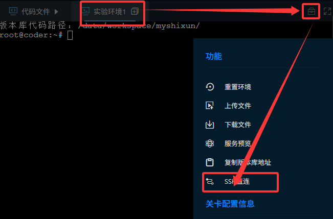
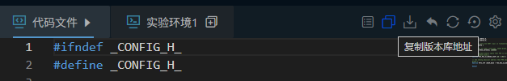

# RISCV代理内核实验代码仓库
本代码仓库是RISCV代理内核实验（RISC-V Proxy Kernel Experiments，简称RISCV PKE）的代码实现，包含了实验所需的内核代码和用户程序代码。每个实验和挑战都有一个独立的分支，方便学习和参考。

各实验和挑战的分支列表：

- [lab1_1_syscall](https://github.com/potatoshred/riscv-pke/commits/lab1_1_syscall)
- [lab1_2_exception](https://github.com/potatoshred/riscv-pke/commits/lab1_2_exception)
- [lab1_3_irq](https://github.com/potatoshred/riscv-pke/commits/lab1_3_irq)
- [lab1_challenge1_backtrace](https://github.com/potatoshred/riscv-pke/commits/lab1_challenge1_backtrace)
- [lab1_challenge2_errorline](https://github.com/potatoshred/riscv-pke/commits/lab1_challenge2_errorline)
- [lab1_challenge3_multicore](https://github.com/potatoshred/riscv-pke/commits/lab1_challenge3_multicore)
----
- [lab2_1_pagetable](https://github.com/potatoshred/riscv-pke/commits/lab2_1_pagetable)
- [lab2_2_allocatepage](https://github.com/potatoshred/riscv-pke/commits/lab2_2_allocatepage)
- [lab2_3_pagefault](https://github.com/potatoshred/riscv-pke/commits/lab2_3_pagefault)
- [lab2_challenge1_pagefaults](https://github.com/potatoshred/riscv-pke/commits/lab2_challenge1_pagefaults)
- [lab2_challenge2_singlepageheap](https://github.com/potatoshred/riscv-pke/commits/lab2_challenge2_singlepageheap)
- [lab2_challenge3_multicoremem](https://github.com/potatoshred/riscv-pke/commits/lab2_challenge3_multicoremem)
---
- [lab3_1_fork](https://github.com/potatoshred/riscv-pke/commits/lab3_1_fork)
- [lab3_2_yield](https://github.com/potatoshred/riscv-pke/commits/lab3_2_yield)
- [lab3_3_rrsched](https://github.com/potatoshred/riscv-pke/commits/lab3_3_rrsched)
- [lab3_challenge1_wait](https://github.com/potatoshred/riscv-pke/commits/lab3_challenge1_wait)
- [lab3_challenge2_semaphore](https://github.com/potatoshred/riscv-pke/commits/lab3_challenge2_semaphore)
---
- [lab3_challenge3_cow](https://github.com/potatoshred/riscv-pke/commits/lab3_challenge3_cow)
- [lab4_1_file](https://github.com/potatoshred/riscv-pke/commits/lab4_1_file)
- [lab4_2_directory](https://github.com/potatoshred/riscv-pke/commits/lab4_2_directory)
- [lab4_3_hardlink](https://github.com/potatoshred/riscv-pke/commits/lab4_3_hardlink)
- [lab4_challenge1_relativepath](https://github.com/potatoshred/riscv-pke/commits/lab4_challenge1_relativepath)
- [lab4_challenge2_exec](https://github.com/potatoshred/riscv-pke/commits/lab4_challenge2_exec)
- [lab4_challenge3_shell](https://github.com/potatoshred/riscv-pke/commits/lab4_challenge3_shell)
---

# 头歌平台上传代码改动方法：

## 方法一：scp（推荐）
本地终端使用scp命令将代码上传到头歌平台:
```bash
scp -r -P XXXXX ./kernel root@47.96.157.89:/data/workspace/myshixun/
```
> 🚩**命令完成后，同步到评测环境会有一定延迟，请耐心`等待几秒钟`后再进行评测。**

ip地址和端口请根据实际情况替换。


## 方法二：git

此方法较麻烦，优点是不会有延迟。第一次使用时，会进行身份认证，请填写头歌平台的用户名和密码。
1. 复制代码仓库地址
2. 本地终端克隆代码仓库
3. 将修改好的代码粘贴覆盖到此代码仓库中
4. 提交并推送代码到远程仓库

此方法推送代码时，注意要`关闭网页`，否则网页中未实现的代码会覆盖掉推送的代码。如果不小心忘了，重新push并加上`--force`参数即可。

# RISCV代理内核实验系列文章

按发布时间排序：

- [RISCV代理内核实验：系统调用、异常和外部中断（一）机器态和内核态](https://potatoshred.github.io/2025/20251210RISCV%20PKE—机器态和内核态)

- [RISCV代理内核实验：系统调用、异常和外部中断（二）ELF解析与程序加载](https://potatoshred.github.io/2025/20251211RISCV%20PKE—ELF解析与程序加载)

- [RISCV代理内核实验：系统调用、异常和外部中断（三）系统调用、异常和外部中断的实现](https://potatoshred.github.io/2025/20251212RISCVPKE—实验一：系统调用、异常和外部中断)

- [RISCV代理内核实验：系统调用、异常和外部中断（四）lab1_challenge1：打印用户程序调用栈](https://potatoshred.github.io/2025/20251213RISCVPKE—实验一：挑战1)

- [RISCV代理内核实验(五)：内存管理](https://potatoshred.github.io/2025/20251214RISCVPKE—内存管理)

- [RISCV代理内核实验(六)：实验二：虚实地址转换、简单内存分配和回收、简单缺页异常、复杂缺页异常处理](https://potatoshred.github.io/2025/20251216RISCVPKE—实验二)

- [RISCV代理内核实验(七)：进程管理](https://potatoshred.github.io/2025/20251218RISCVPKE—进程管理)

- [RISCV代理内核实验(八)：实验三：fork、yield、循环轮转调度、wait](https://potatoshred.github.io/2025/20251219RISCVPKE—实验三)

- [RISCV代理内核实验(九)：文件系统](https://potatoshred.github.io/2025/20251220RISCVPKE—文件管理)

- [RISCV代理内核实验(十)：实验四——文件系统：文件、目录文件、硬链接、相对路径](https://potatoshred.github.io/2025/20251221RISCVPKE—实验四)

- [RISCV代理内核实验(11)：lab1_challenge2 打印异常代码行](https://potatoshred.github.io/2025/20251222RISCVPKE—lab1_c2)

- [RISCV代理内核实验(12)：lab1_challenge3 multicore多核](https://potatoshred.github.io/2025/20251222RISCVPKE—lab1_c3)

- [RISCV代理内核实验(13)：lab2_challenge2 堆空间管理singlepageheap](https://potatoshred.github.io/2025/20251222RISCVPKE—lab2_c2)

